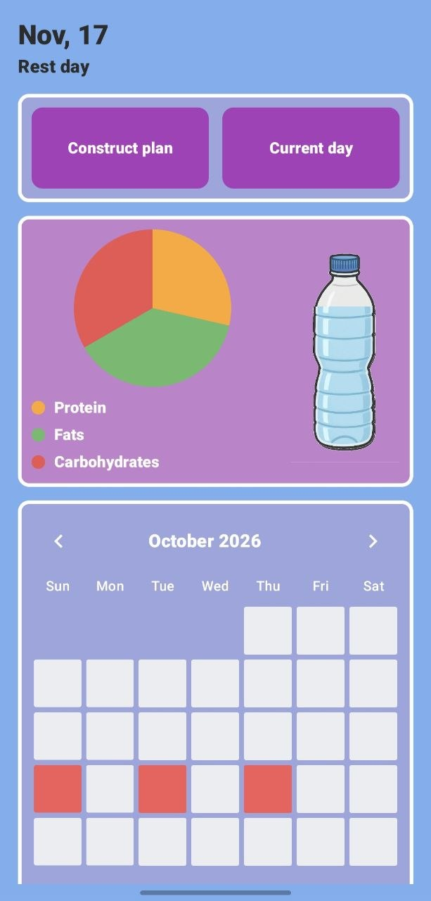
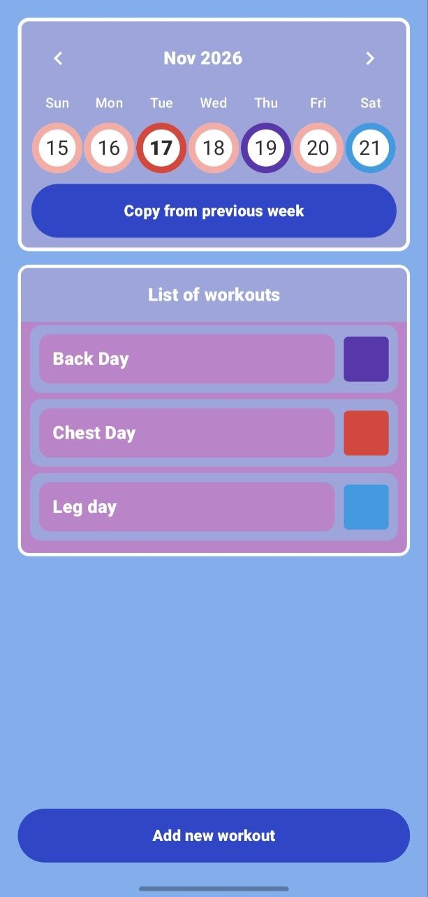
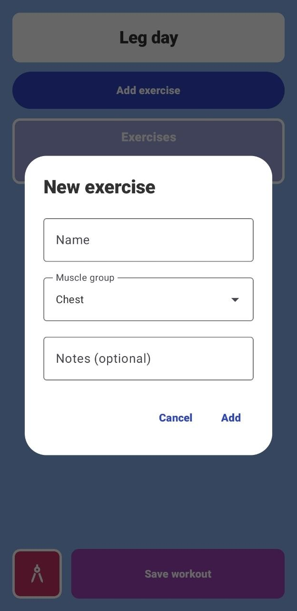
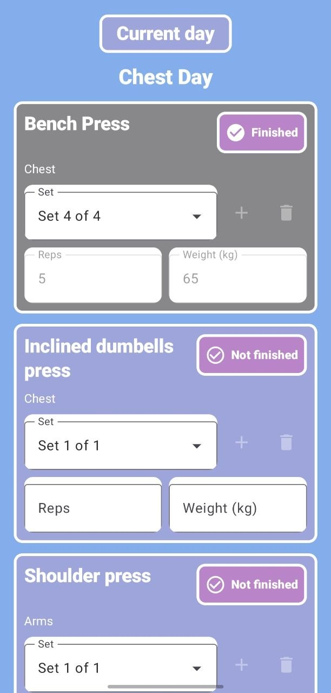

# ProJacked

I was frustrated that I'm inconsistent in the gym and created a workout planner and training log for Android, built with Jetpack Compose.
You can Plan your week, build training days, and log every set. This is a port from my older [project](https://github.com/Ducnnn/Project-Gym). 
Claude Code was used port it form Android XML views to Jetpack Compose to continue its development using the latest frameworks.
The app is in development stage as new functionality for nutrition will be added.

## Screenshots

| Home | Training plan | Day constructor | Current day |
|---|---|---|---|
|  |  |  |  |

## Features

- Sign up and sign in with email and password
- Weekly training plan with colour-coded days
- Day constructor for building workout templates
- Set-by-set workout logger (reps and weight)
- Attendance heatmap on the Home screen
- Macro calculator and profile parameters

## Tech stack

- Kotlin, Jetpack Compose, Material 3
- Navigation Compose, ViewModel and StateFlow
- Hilt (KSP) for dependency injection
- Firebase Auth and Cloud Firestore

## Getting started

1. Clone the repository.
2. Download your own `google-services.json` from the Firebase console and put it in `app/` (it is not committed).
3. Debug builds talk to the Firebase Local Emulator Suite:
   ```
   firebase emulators:start --only auth,firestore
   ```
4. Build and run with Android Studio, or:
   ```
   ./gradlew assembleDebug
   ```

Requires Android 8.0 (API 26) or newer.

## License

Apache License 2.0. See [LICENSE](LICENSE).
